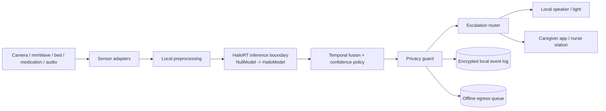

# Formosa Care Guardian — Edge Care Node

A privacy-first, offline-capable Edge AI prototype for aging-in-place and long-term care. Built for the **ASUS UGen AI League / Battlefield Lightning / Onsite Track** and targeted at an **ASUS UGen300 (Hailo-10H) accelerator**.

> Proposed public repository URL: `https://github.com/kechi680910/edge-care-guardian`
>
> This package is GitHub-ready. Before the 14 Oct 2026 deadline, keep the public repo here and make sure the pitch deck's GitHub reference matches this URL.

## What the prototype demonstrates

- Local event processing for all four care moments: **fall, wandering, missed medication, distress cues**.
- Privacy guard that converts raw sensor observations into minimum-necessary event metadata.
- Deterministic escalation policy: local prompt → caregiver app → nurse station.
- **Offline-first egress queue** plus an **encrypted local audit log** — critical alerts keep flowing without a network.
- A **HailoRT seam** (`HailoModel` / `NullModel`) that makes the Stage I (simulated) and Stage II (live inference) perception paths interchangeable.

## Why edge-first

Private rooms and bathrooms demand dignity; critical alerts cannot depend on a cloud round trip. The deployment keeps raw camera / radar / audio / bed-sensor signals local. Only structured, privacy-projected events leave the room after policy checks.

## Quick start (simulation mode, zero dependencies)

```bash
python -m venv .venv
. .venv/Scripts/activate   # Windows ; on macOS/Linux: source .venv/bin/activate
pip install -e .
python -m formosa_guardian.demo
python -m unittest discover -s tests -v
```

The demo drives all four care moments through one offline loop, simulates a network outage, flushes the pending egress queue, and writes an encrypted audit receipt. It prints a `demo-receipt.json` with the privacy-projected egress samples.

## Architecture



See [`docs/architecture.md`](docs/architecture.md) for hardware mapping, Stage II integration steps, and data-flow rules.

## Repository map

```text
src/formosa_guardian/
  events.py          Typed sensor frames, care events, actions, queued payloads
  detectors.py       Fall / Wandering / Medication / Distress temporal detectors
  fusion.py          Debounce and event fusion
  privacy.py         Minimum-necessary event projection and pseudonymization
  policy.py          Escalation decision rules
  pipeline.py        Offline egress queue + encrypted local audit log
  runtime.py         End-to-end local pipeline (detect -> fuse -> project -> route)
  hailo_adapter.py   HailoRT integration seam (NullModel for Stage I, HailoModel for Stage II)
  demo.py            Reproducible demonstration of all four care moments
configs/default.json
models/model_card.md
benchmarks/stage2_metrics.csv
tests/test_pipeline.py
```

## Stage II targets (to be measured on UGen300)

| Metric | Target | Test method |
|---|---:|---|
| Fall-event recall | ≥95% | Staged fall / non-fall clips, subject-disjoint split |
| False alerts | ≤1 / room-day | 72-hour scripted-room pilot |
| Event-to-alert latency | ≤250 ms | Timestamp at sensor ingress and router output |
| Offline continuity | 100% critical rules | Disconnect network during scenario suite |
| Raw private media uploaded | 0 bytes | Packet capture + egress allowlist audit |

Targets are not presented as completed results. Record measured values in `benchmarks/stage2_metrics.csv`.

## Hailo integration plan

1. Export the chosen detector/pose model to ONNX.
2. Quantize and compile it with the Hailo Dataflow Compiler for Hailo-10H (`scripts/compile_hailo.sh`).
3. Place the compiled model in a local deployment dir (do not commit licensed artifacts).
4. In the target environment, build `HailoModel(model_path)` — it lazily imports `hailort`, so the rest of the codebase has no Hailo dependency.
5. Run the same policy, privacy, and alert tests against live inference; the `CareRuntime` seam is unchanged.

## Safety and scope

This prototype is a care-assistance system, not a medical device. It must not diagnose, prescribe, or replace professional judgment. High-risk events are always escalated to a human caregiver. Deployment requires consent, site-specific validation, access control, and an incident-response procedure.

## License

Apache-2.0. Third-party models, datasets, and SDKs retain their respective licenses.
